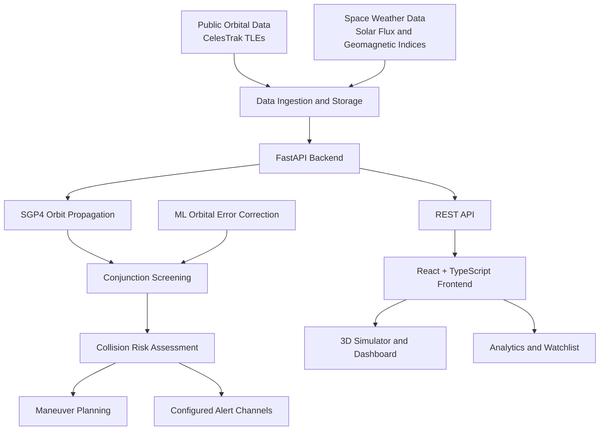

# 🛰️ Gagan Suraksha
### Satellite Debris Monitoring & Collision-Risk Prediction Platform

<p align="center">
  
  
  
  
</p>

<p align="center">
  <strong>Making Earth's orbital environment easier to visualize, monitor, and analyze.</strong>
</p>

Gagan Suraksha is an aerospace monitoring and collision-risk prediction platform designed to support **Space Situational Awareness (SSA)**. It combines 3D orbital visualization, satellite tracking, conjunction screening, machine-learning-based orbital error correction, and collision avoidance maneuver planning in one integrated interface.

The platform retrieves public orbital data, propagates satellite trajectories using SGP4, identifies potential close approaches, and provides analytical tools to evaluate collision risk and explore possible avoidance maneuvers.

> **Project status:** Engineering prototype and research platform. It is not affiliated with, endorsed by, or officially operated by ISRO.

---

## 📑 Table of Contents

- [Overview](#-overview)
- [Key Features](#-key-features)
- [Application Modules](#-application-modules)
- [Technology Stack](#-technology-stack)
- [System Architecture](#-system-architecture)
- [Getting Started](#-getting-started)
- [Docker Deployment](#-docker-deployment)
- [API Reference](#-api-reference)
- [Machine Learning Pipeline](#-machine-learning-pipeline)
- [Testing and Validation](#-testing-and-validation)
- [Security](#-security)
- [Data Sources and Limitations](#-data-sources-and-limitations)
- [Project Structure](#-project-structure)
- [Future Scope](#-future-scope)
- [Disclaimer](#️-disclaimer)

---

## 🚀 Overview

Space is becoming increasingly crowded with operational satellites, inactive spacecraft, and orbital debris. Close approaches between these objects require careful monitoring because inaccurate trajectory predictions and uncertain orbital states can complicate collision-risk assessment.

Gagan Suraksha addresses this challenge through an integrated workflow:

1. **Track:** Retrieve public satellite orbital elements and relevant space-weather information.
2. **Visualize:** Explore Earth, spacecraft, debris, and orbital trajectories in an interactive 3D environment.
3. **Screen:** Identify potential conjunction events and evaluate miss distance, relative velocity, and estimated collision probability.
4. **Predict:** Apply machine-learning-based orbital error correction to estimate propagation drift.
5. **Analyze:** Compare classical and ML-calibrated collision-risk estimates.
6. **Plan:** Explore hypothetical collision avoidance maneuvers and their estimated fuel costs.

### 🎯 Project Objectives

- Provide an interactive environment for satellite and debris monitoring.
- Visualize orbital motion and close-approach geometry.
- Support conjunction screening and collision-risk assessment.
- Investigate ML-assisted correction of SGP4 propagation errors.
- Estimate maneuver-related delta-v, miss-distance changes, and propellant consumption.
- Present model performance and data freshness through a unified dashboard.

---

## ✨ Key Features

| Feature | Description |
|---|---|
| 🌍 Interactive 3D Earth | Explore spacecraft, debris, orbital paths, and close-approach geometry. |
| 🛰️ Satellite Tracking | Retrieve and monitor orbital objects using public orbital element data. |
| ⚠️ Conjunction Screening | Review close approaches using TCA, miss distance, relative velocity, and estimated collision probability. |
| 🧠 ML-Based Error Correction | Predict orbital propagation residuals using gradient-boosted quantile regression. |
| 🛡️ Maneuver Planning | Explore hypothetical avoidance burns and their estimated fuel costs. |
| 📊 Model Analytics | Examine probability calibration, alert comparisons, and propagation-error horizons. |
| 📋 Asset Watchlist | Add monitored objects and customize screening thresholds. |
| 🔔 Alert Configuration | Configure supported notification channels and collision-alert settings. |
| 🔄 Live Data Refresh | Refresh orbital and space-weather data through scheduled backend jobs. |
| 🔐 Secure Webhooks | Apply URL validation, private-address restrictions, timeouts, and credential-safe logging. |

---

## 🖥️ Application Modules

### 1. 3D Orbital Simulator — `/simulator`

The simulator is the primary visualization interface.

- Interactive 3D Earth with procedural surface details and atmospheric rendering.
- Orbital propagation and Earth orientation using Greenwich Mean Sidereal Time (GMST).
- Instanced rendering of spacecraft and debris objects.
- Object selection, hover tooltips, and satellite telemetry.
- Orbital regime filters: LEO, MEO, GEO, and ALL.
- Toggleable orbit lines and object layers.
- Close-approach visualization with orbital planes, TCA markers, and miss-distance vectors.
- Playback controls with adjustable simulation speed and a seven-day timeline.

### 2. Conjunction Assessment — `/conjunctions`

A structured interface for reviewing potential close approaches.

- Object pairs and NORAD catalog identifiers.
- Time of Closest Approach (TCA) in UTC.
- Miss distance and relative velocity.
- Estimated collision probability (\(P_c\)).
- Risk-level filtering: Critical, Warning, and Nominal.
- Search, sorting, and watchlist filtering.
- Automatic refresh with data-freshness indicators.

### 3. Event Details & Maneuver Planner — `/conjunctions/:id`

Analyze individual conjunction events and explore hypothetical avoidance maneuvers.

**Conjunction analysis**
- Radial, in-track, and cross-track miss-distance components.
- Relative velocity and estimated position uncertainty.
- Classical Foster 2D versus ML-calibrated collision-probability comparison.

**Maneuver simulation**
- Delta-v selection from 0.00 to 1.50 m/s.
- Burn lead-time options: TCA − 24h, 12h, 6h, and 2h.
- Thrust directions: Prograde, Retrograde, Radial, and Normal.
- Estimated post-maneuver miss distance and collision probability.
- Propellant consumption estimation using the Tsiolkovsky rocket equation.
- Maneuver recommendations based on the application's modeled assumptions.

The interface also supports dispatching maneuver telemetry through `POST /api/maneuver`.

### 4. Analytics Dashboard — `/analytics`

Understand the behavior of the prediction and screening pipeline through three primary visualizations.

1. **Alert Comparison:** Baseline versus ML-corrected alert counts, including missed-event indicators where available.
2. **Probability Calibration:** Predicted collision probability compared with empirical event frequency.
3. **Propagation Error Horizon:** Comparison of standard SGP4 propagation drift and ML-corrected error across forecast horizons.

The metrics endpoint may return sample data and explicitly identifies demo metrics using `isDemo: true`.

### 5. Asset Watchlist & Settings — `/watchlist`

Manage monitored orbital objects and screening configuration.

- Add or remove objects using NORAD IDs and names.
- Select orbital regimes and configure screening thresholds.
- Set collision-alert thresholds.
- Configure supported email, Telegram, and webhook notification channels.
- Review the reported health and ingestion latency of available data services.

---

## 🛠️ Technology Stack

### Frontend

| Technology | Purpose |
|---|---|
| React 19 | Component-based user interface |
| TypeScript | Typed application logic and API contracts |
| Vite 8 | Development server and build tooling |
| Tailwind CSS v4 | Styling and design system |
| Three.js | 3D rendering |
| React Three Fiber | React-based 3D scene management |
| `@react-three/drei` | 3D utilities and helpers |
| Zustand | Simulation state management |
| TanStack Query | Data fetching, caching, and polling |
| Axios | HTTP communication |
| Recharts | Analytics visualizations |

### Backend

| Technology | Purpose |
|---|---|
| Python | Backend and ML implementation |
| FastAPI | REST API and OpenAPI documentation |
| Uvicorn | ASGI server |
| SQLAlchemy | Database access and ORM |
| SQLite | Local and prototype persistence |
| Pydantic | Data validation and API schemas |
| APScheduler | Scheduled background tasks |
| HTTPX | External API communication |

### Orbital Mechanics & Machine Learning

- **SGP4:** Satellite trajectory propagation from Two-Line Element (TLE) data.
- **GMST:** Earth orientation for orbital visualization.
- **NumPy and SciPy:** Numerical computation.
- **Pandas:** Dataset preparation and processing.
- **Scikit-learn:** Supporting ML utilities and evaluation.
- **XGBoost:** Quantile regression for orbital propagation residuals.
- **Joblib:** Model artifact serialization.

---

## 🏗️ System Architecture



### Data Flow

1. Public orbital and space-weather data are retrieved by the backend.
2. Satellite states are propagated using SGP4.
3. Conjunction screening evaluates candidate close approaches.
4. ML-based error correction supports modeled trajectory uncertainty analysis.
5. Collision-risk calculations produce screening estimates.
6. The API exposes satellite, conjunction, maneuver, watchlist, and analytics data.
7. The frontend renders the results in the simulator and dashboard.

---

## ⚙️ Getting Started

### Prerequisites

Install the following before running the project:

- Python 3.11 or newer.
- Node.js and npm.
- Git.
- A modern web browser.

For containerized deployment, install Docker Desktop with Docker Compose support.

### 1. Clone the repository

Replace the example URL with your actual GitHub repository URL.

```bash
git clone https://github.com/Avneet-Chahal/GaganSuraksha.git
cd GaganSuraksha
```

Ensure that you are inside the directory containing `requirements.txt` and `package.json`.

### 2. Set up the Python backend

Create a virtual environment:

```bash
python -m venv .venv
```

Activate it on Windows Command Prompt:

```cmd
.venv\Scripts\activate.bat
```

On Windows PowerShell:

```powershell
.\.venv\Scripts\Activate.ps1
```

On Linux or macOS:

```bash
source .venv/bin/activate
```

Install the Python dependencies:

```bash
python -m pip install --upgrade pip
pip install -r requirements.txt
```

### 3. Start the backend

From the project root, run:

```bash
python -m uvicorn backend.main:app --host 127.0.0.1 --port 8000 --reload
```

Keep this terminal running.

### 4. Set up the frontend

Open a second terminal and navigate to the project root.

Install dependencies:

```bash
npm install
```

Start the development server:

```bash
npm run dev
```

Open the local URL printed by Vite.


The exact port depends on the local Vite configuration and port availability.

### 5. Verify the installation

Check that:

- The backend starts without import or configuration errors.
- The health endpoint returns a successful response.
- The frontend loads in your browser.
- The frontend can communicate with the backend.
- The simulator, conjunction table, analytics, and watchlist load their available data.

---

## 🐳 Docker Deployment

The project includes Docker configuration for containerized backend deployment.

Build and start the configured services:

```bash
docker compose up --build
```

Run in detached mode:

```bash
docker compose up -d
```

View service logs:

```bash
docker compose logs -f
```

Stop the services:

```bash
docker compose down
```

The configured SQLite storage uses a named Docker volume, `gagan_suraksha_sqlite_data`, mounted at `/app/data/gagan_suraksha.db`.

Check `docker-compose.yml` for the exact services, ports, environment variables, and volume configuration before deployment.

---

## 🔌 API Reference

All application endpoints are mounted under the `/api` prefix and return JSON responses.

| Method | Endpoint | Purpose |
|---|---|---|
| `GET` | `/api/health` | Backend health status |
| `GET` | `/api/satellites` | Retrieve tracked satellites and orbital data |
| `GET` | `/api/trajectories` | Retrieve SGP4-propagated trajectory points |
| `GET` | `/api/conjunctions` | Retrieve screened close-approach events |
| `GET` | `/api/conjunctions/{id}` | Retrieve a specific conjunction and its details |
| `POST` | `/api/maneuver` | Evaluate a hypothetical collision avoidance maneuver |
| `GET` | `/api/watchlist` | Retrieve monitored assets |
| `POST` | `/api/watchlist` | Add or update a monitored asset |
| `DELETE` | `/api/watchlist/{id}` | Remove a watchlist asset |
| `GET` | `/api/alert-settings` | Retrieve alert configuration |
| `PUT` | `/api/alert-settings` | Update alert thresholds and dispatch configuration |
| `GET` | `/api/metrics` | Retrieve model-performance metrics |
| `GET` | `/api/sources` | Retrieve reported data-source and engine status |

### Example: Health Check

```bash
curl http://127.0.0.1:8000/api/health
```

### Example: Retrieve Satellites

```bash
curl "http://127.0.0.1:8000/api/satellites?limit=20"
```

For complete request schemas, supported query parameters, and response examples, run the backend.

---

## 🧠 Machine Learning Pipeline

Gagan Suraksha includes a physics-informed, gradient-boosted quantile regression pipeline for estimating and correcting SGP4 orbital propagation residuals over forecast horizons of one to seven days.

### Orbital Error Decomposition

Position residuals are represented as:

\[
\Delta \vec{r} = \vec{r}_{\mathrm{prop}} - \vec{r}_{\mathrm{ref}}
\]

The residuals are mapped into the orbital RTN reference frame:

- **Radial (R):** Along the radial direction.
- **In-track (T):** Along the orbital direction of motion.
- **Cross-track (N):** Normal to the orbital plane.

### Model Inputs

The feature pipeline includes:

- Forecast horizon and altitude.
- Mean motion, inclination, and eccentricity.
- Ballistic drag coefficient \(B^*\).
- Solar radio flux \(F_{10.7}\) and its centered 81-day average.
- Geomagnetic indices, including \(K_p\) and \(A_p\).
- Space-weather summaries over the propagation interval.

### Model Design

- Separate XGBoost quantile regression models for radial, in-track, and cross-track residuals.
- Quantiles at 0.10, 0.50, and 0.90 using quantile loss.
- Chronological training, validation, and testing splits of 70%, 15%, and 15%.
- Temporal separation intended to prevent future information from leaking into training.
- Serialized model artifacts and evaluation metadata.

### Training the Model

Run the training pipeline from the project root:

```bash
python backend/app/ml/train.py
```

Optional Space-Track credentials may be supplied through the script's supported command-line arguments:

```bash
python backend/app/ml/train.py --spacetrack-user <USER> --spacetrack-password <PASS>
```

Use environment variables or a secure local configuration when appropriate. Never commit real credentials to source control.

The associated training notebook is:

`notebooks/tle_error_correction_training.ipynb`

---

## 🧪 Testing and Validation

Run the backend test suite:

```bash
pytest -v
```

Run frontend linting:

```bash
npm run lint
```

Build the frontend for production:

```bash
npm run build
```

The project documentation describes a 48-test backend suite covering areas including:

- SGP4 propagation.
- Foster 2D collision-probability calculations.
- Tsiolkovsky rocket dynamics.
- SSRF webhook protection.
- Alert deduplication.
- REST API endpoints.

These are documented test targets; run the commands above to verify the current state of the code.

---

## 🔐 Security

The application implements several safeguards for outgoing alert notifications and webhook configuration:

- HTTPS-only webhook URL validation.
- DNS resolution and checks against private, loopback, link-local, and cloud metadata addresses.
- Rejection of webhook URLs containing embedded credentials.
- Destination revalidation before dispatch to mitigate DNS-rebinding risks.
- Five-second timeouts for external network requests.
- Masked logging for secrets, passwords, bot tokens, and sensitive webhook URL parameters.
- Alert deduplication to reduce repeated notifications for the same conjunction.

### Security Best Practices

- Never commit `.env` files or API credentials.
- Keep `.env.example` limited to placeholder values.
- Exclude local virtual environments, `node_modules`, databases, and generated artifacts when they should not be shared.
- Review Docker configuration before exposing services to a network.
- Treat collision-risk estimates as analytical screening outputs, not operational flight commands.

---

## 🌐 Data Sources and Limitations

### Orbital Data

Public Two-Line Element sets are retrieved from the CelesTrak GP API and historical archives.

TLE data are designed for general perturbations propagation with SGP4 and are subject to uncertainties, including atmospheric drag and orbital decay.

### Space Weather

The system uses available solar-flux and geomagnetic indices to support orbital error modeling.

### Reference Data for ML Evaluation

Without classified radar observations or high-precision numerical Conjunction Data Messages, the documented evaluation approach uses subsequent TLE epoch states propagated with SGP4 as reference states.

Consequently, the model learns against an imperfect reference and does not establish independently verified orbital truth.

### Covariance and Collision Probability

- Public TLEs do not provide the full state covariance information available in some operational conjunction data products.
- Position uncertainty is estimated using an empirical growth model based on TLE age and forecast lead time.
- Collision probability uses the Foster 2D encounter-plane model with a spherical hard-body radius and Gaussian positional uncertainty assumptions.

**Important:** These estimates support research and screening prioritization. They should not replace high-precision ephemeris, validated covariance analysis, or qualified operational collision-avoidance procedures.

---

## 📁 Project Structure

The main project components are organized as follows:

```text
GaganSuraksha/
├── backend/                 # FastAPI application and backend logic
├── services/                # Screening and risk-related services
├── src/                     # React + TypeScript frontend
│   ├── api/                  # API clients and data types
│   ├── components/           # Shared UI components
│   ├── features/             # Simulator and feature modules
│   ├── pages/                # Application pages
│   └── store/                # Simulation state management
├── ml/                      # ML-related project assets
├── notebooks/                # Model training and analysis notebooks
├── tests/                    # Automated tests
├── public/                   # Static frontend assets
├── requirements.txt          # Python dependencies
├── package.json              # Node.js dependencies and scripts
├── Dockerfile                # Container build configuration
├── docker-compose.yml         # Container orchestration
├── index.html                # Frontend HTML entry point
├── .env.example              # Safe configuration template
└── README.md                 # Project documentation
```

Some additional directories and model artifacts may be present depending on the current project version.

---

## 🔮 Future Scope

Potential future improvements include:

- Integration with additional verified orbital data providers.
- More rigorous uncertainty propagation and covariance estimation.
- Independent validation against higher-precision reference ephemerides.
- Expanded model evaluation across satellite classes and orbital regimes.
- Improved alert delivery monitoring and operational observability.
- Reproducible model-training pipelines and automated evaluation reports.
- Deployment hardening, authentication, and role-based access controls.

These are potential enhancements, not claims that all capabilities are currently implemented.

---


## 🔗 Live Links

- **Live Frontend:** https://gagan-suraksha.vercel.app/
- **Backend API:** https://gagansuraksha.onrender.com
- **API Documentation (Swagger):** https://gagansuraksha.onrender.com/docs

---

## ⚠️ Disclaimer

Gagan Suraksha is an engineering prototype and research platform for satellite situational awareness, orbital visualization, conjunction screening, and collision-risk analysis.

It is **not affiliated with, endorsed by, or officially operated by the Indian Space Research Organisation (ISRO)**.

Its trajectory predictions, uncertainty estimates, collision probabilities, and maneuver calculations depend on the available data, modeling assumptions, and software implementation. They are not certified operational guidance and must not be used as the sole basis for real spacecraft maneuver decisions.

---

<p align="center">
  <strong>Gagan Suraksha</strong><br/>
  Exploring safer and more informed orbital operations through visualization, astrodynamics, and machine learning.
</p>
